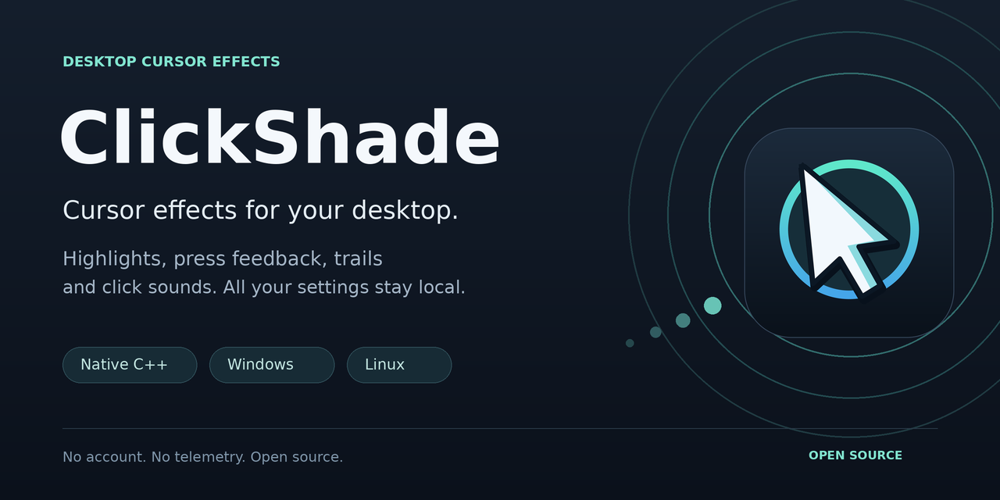
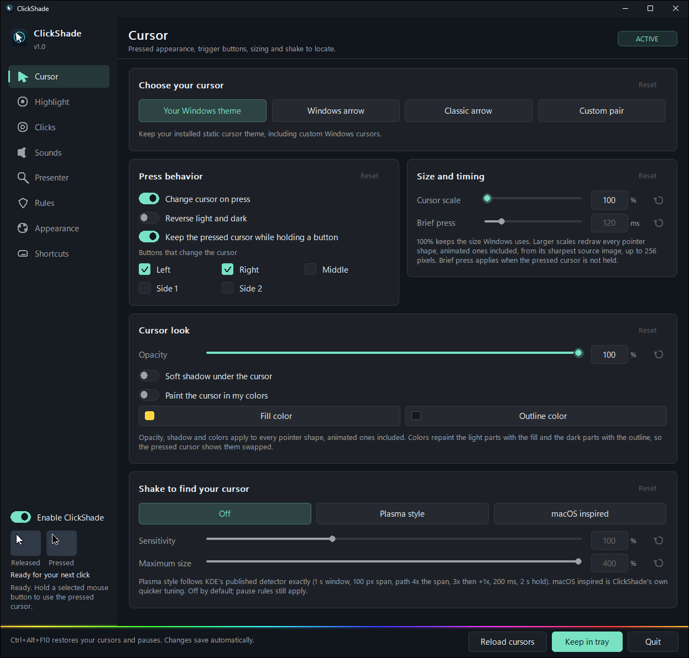

ClickShade makes your mouse pointer easier to follow and a bit more fun to use. Hold a mouse button and the cursor goes dark. Put a highlight, a spotlight or a crosshair under it. Give each mouse button its own click animation and sound, add a typing sound if you like, and shake the mouse when you've lost the pointer. It's a native C++ app for Windows with a Linux port, and nothing leaves your computer.

> [!NOTE]
> This project is vibe coded. It's made by one person who picked the features, tested everything on their own machines and decided what ships, with AI coding assistants writing a large share of the code. It's a first release, so if something looks off, please [open an issue](../../issues).

> [!IMPORTANT]
> While it runs, ClickShade replaces the Windows system cursors with its own copies and restores the originals when it pauses or quits. If it is ever closed the hard way, run `Restore-cursors.cmd` from the download or `ClickShade.exe --restore`. The Windows build is unsigned, so SmartScreen may warn on first start.



## Features

| Feature | What you get |
| --- | --- |
| Cursor on press | Hold a mouse button and the cursor switches to a dark version; release and it comes back. Reverse light and dark, keep it while holding or flash it briefly, and choose which buttons trigger it. |
| Cursor styles and size | Your installed theme, the Windows arrow, a classic arrow drawn crisply at any size, or your own `.cur` pair. A cursor scale from 100% to 600% of the size Windows uses applies to every cursor shape, the busy spinner included. |
| Cursor look | Fade the cursor down to 30% opacity, give it a soft drop shadow, or paint it in your own fill and outline colors. Like the scale, the look reaches every cursor shape, animated ones included, and works with or without the press effect. |
| Shake to find | A Plasma-style preset that follows KWin's published detector exactly, or a macOS-inspired one that reacts to a couple of quick wiggles. Sensitivity and maximum size are yours to set. |
| Highlight | Filled, ring, soft glow, crosshair, or a spotlight that dims the rest of the screen. Color, radius, opacity and width, optional breathing, and hide-when-resting. |
| Trails | Dots, rings, sparkles, a tapered comet or a fine sparkle, with color, size, opacity and fade. Off by default. |
| Click effects | Ring, pulse, ripple, burst, neon ring, or a target that closes in on the click. Left, right and middle buttons each have their own switch and color; neon blue, neon red and neon green by default. |
| Click sounds | Eleven original sets including the classic mouse click, each dropdown listing only the files made for that button, or any WAV, MP3, FLAC, M4A or AAC file. |
| Keyboard sounds | A separate switch, volume and shortcut. Five sets, from classic typing to a typewriter, with shuffled key variants plus space, enter and backspace. |
| Magnifier | A live lens that follows the pointer, round or rounded square, centered on the pointer or beside it, 1.25× to 8×. Your own highlights and click effects stay out of it. |
| Key display | The keys you press, shown as keycaps on rounded panels in the style of the Mac keystroke visualizers: shortcuts only (Ctrl, Alt or Win chords and function keys) or every key, with typed letters joined into words. Optional mouse buttons, four positions, size, hold time and colors. A row lives only while it is on screen. |
| Smart pause | Pauses in fullscreen apps, when a game confines the pointer and on the lock screen. Exclude any executable, or allow-list the desktop tools that should keep working. |
| Administrator mode | Optional. Keeps effects, shortcuts and held-button tracking working over Task Manager, installers and other elevated windows. |
| Recordings | Effects show up in OBS, ShareX, the Snipping Tool and similar tools. One switch keeps them off recordings instead. |
| Crash recovery | If ClickShade crashes, it restores your cursors first, writes a report to the settings folder, and comes back once with a note. |
| Settings window | A sidebar, compact cards, a reset on every card and every slider, dark and light palettes, extra zoom, and an animated spectrum line you can turn off. |
| Everyday controls | Nine global shortcuts, tray menu, optional start with Windows, settings profiles with backup and import, and a full defaults reset. |

### What ClickShade does not do

- It never moves the pointer, changes mouse speed or acceleration, or replays input. Effects follow the position Windows reports.
- It does not record what you type. Keyboard input is observed only while keyboard sounds or the key display are on. Sounds only learn whether an ordinary key, Space, Enter or Backspace went down; the key display turns a press into a keycap or a typed character that is dropped as soon as its row fades.
- It has no account, telemetry, activity log, updater or network service.
- It does not inject into games or work around anti-cheat. It pauses in fullscreen games by default; quit it entirely if a game's rules require that.

## Requirements

**Windows:** Windows 10 version 1703 or later, or Windows 11, 64-bit. No installer, no runtime to install.

**Linux:** an x86-64 system with GTK 3.24, GLib, Cairo, X11 with XInput 2.1 and XFixes 4, a compositing window manager, and GLIBC 2.38 / GLIBCXX 3.4.32 or newer. Sound uses PulseAudio or PipeWire's PulseAudio service. GNOME on Wayland needs the bundled Shell extension; other Wayland compositors are not supported. See [linux/README.md](linux/README.md).

## Install

1. Download `ClickShade-<version>-Windows-Linux.zip` from [Releases](../../releases) and extract it somewhere permanent. The `sounds` folder must stay next to the executable.
2. **Windows:** run `Windows/ClickShade.exe`. **Linux:** run `Linux/ClickShade` (`chmod +x ClickShade` first if extraction dropped the executable bit).
3. The settings window opens. Closing it keeps ClickShade in the tray; **Quit** restores your cursors and exits.

Out of the box, a held left or right button darkens the cursor, a yellow highlight follows the pointer, and clicks draw neon blue and neon red rings. Sounds, trails, shake-to-locate, middle-click effects, the magnifier, the key display, administrator mode and start with Windows are off until you turn them on.

`CHECKSUMS.sha256` in the ZIP covers every file. To keep settings next to the executable instead of in your profile, create an empty file named `ClickShade.portable` beside `ClickShade.exe`.

## Using it

The window has eight pages. Every setting saves as you change it, and every card has a **Reset** that only lights up when something in it differs from the default.

| Page | What is there |
| --- | --- |
| Cursor | Cursor style, press behavior, trigger buttons, cursor scale and brief-press timing, cursor look (opacity, shadow, colors), shake to find. |
| Highlight | Highlight style and tuning, breathing, idle hide, trails, three one-click presets. |
| Clicks | Per-button switches and colors, click style, radius, duration, opacity, width, easing. |
| Sounds | Click sounds per button, keyboard sound set, both volumes, library refresh. |
| Presenter | Magnifier lens (shape, placement, zoom, size, frame color or no frame) and key display (what to show, mouse buttons, position, size, hold time, opacity, backdrop). |
| Rules | Fullscreen and confined-pointer pause, excluded and allowed apps, administrator mode, recording visibility, startup. |
| Appearance | Dark or light palette, presets and custom colors, extra zoom, spectrum line, frame pacing for all effects, profiles, restore all defaults. |
| Shortcuts | Nine global shortcuts, recorded or typed. |

[docs/SETTINGS.md](docs/SETTINGS.md) explains every control and range.

### Shortcuts and tray

| Action | Default |
| --- | --- |
| Restore cursors and pause | **Ctrl+Alt+F10** on Windows, **Ctrl+Shift+F10** on Linux |
| Toggle all effects, highlight, clicks, click sounds, keyboard sounds, magnifier, key display, show settings | Unassigned until you set them |

The tray menu offers the same toggles, restore and quit. Shortcuts need Ctrl, Alt or Win plus a key; Windows reserves F12.

### Command line

| Command | Effect |
| --- | --- |
| `ClickShade.exe` | Open the settings window, or bring the running instance forward |
| `ClickShade.exe --tray` | Start in the tray |
| `ClickShade.exe --restore` | Restore the Windows cursors and pause the running instance |
| `ClickShade.exe --quit` | Quit the running instance |
| `ClickShade.exe --no-elevate` | Start without the administrator relaunch this time |
| `ClickShade.exe --version` | Show the version |

Only one instance runs per session; a second launch just opens the settings window. The Linux binary accepts `--background`, `--restore`, `--quit`, `--version` and `--help`.

## Troubleshooting

| Symptom | Likely cause |
| --- | --- |
| The cursor stayed dark or changed after ClickShade was killed | Run `Restore-cursors.cmd` from the download or `ClickShade.exe --restore`; signing out also resets the scheme. |
| Effects vanish over Task Manager, installers or some games | Those windows run elevated. Turn on **Run ClickShade as administrator** on the Rules page. |
| Effects pause in a windowed game or a full-screen browser | The fullscreen or confined-pointer rule fired. Add the app to **Always allow in these apps**, or turn the rule off. |
| No effects in a particular app | It may be in the excluded list, or the session is locked, or the app hides the pointer itself. |
| Effects missing from OBS or ShareX recordings | **Show effects in screenshots and recordings** is off on the Rules page. |
| No sound | Sounds are off by default. Use **Test** next to a file; a missing codec or device shows an error on the Sounds page. |
| A shortcut does nothing | Another app owns that combination, or it is a bare key. Pick a different chord; the page reports conflicts. |
| The magnifier reports an error or stays hidden | The Windows Magnification API is missing or blocked in that session (some stripped-down or remote setups). Every other effect keeps working. |
| The key display shows nothing while typing | **Shortcuts only** is selected. Press a Ctrl, Alt or Win chord, or choose **Every key** on the Presenter page. |
| SmartScreen or antivirus warns about the EXE | The binary is unsigned. Build from source if you want to verify it; see [SECURITY.md](SECURITY.md). |
| Linux: no highlights or click effects | X11 needs a compositing window manager and XInput 2.1. On GNOME Wayland, install the extension from `Linux/gnome-extension`. |

## Uninstall

Turn off **Start with Windows** (and administrator mode, which removes its scheduled task), choose **Quit**, then delete the extracted folder. Settings live in `%LOCALAPPDATA%\ClickShade` on Windows and `~/.config/clickshade` on Linux; delete them too if you want a clean slate. ClickShade never deletes sound or cursor files you selected.

## Platform support

| Capability | Windows | Composited Linux X11 | GNOME Wayland adapter |
| --- | --- | --- | --- |
| Highlight styles, breathing, idle hide | Yes | Yes | Experimental (spotlight drawn as a glow) |
| Left, right and middle click styles | Yes | Yes | Experimental |
| Five trail styles | Yes | Yes | Not implemented |
| Current cursor dark on press | Native system-role replacement | Software overlay of the current static cursor | Not implemented |
| Reverse, custom pairs, default/classic presets, cursor sizing | Yes | Not implemented | Not implemented |
| Shake-to-locate enlargement | Cached native system arrow | Cached current-cursor overlay | Use compositor facilities |
| Magnifier lens | Windows Magnification API, centered or beside the pointer, own overlays excluded | Beside the pointer, read from the screen about 30 times a second | Square lens beside the pointer, cloned from the window layer |
| Key display | Yes | Yes | Yes (Shell widgets) |
| Fullscreen pause, app exclusions and allowances | Yes | Yes | Compositor-specific |
| Administrator mode, capture visibility, crash recovery | Yes | Not applicable | Not applicable |
| Global shortcuts | RegisterHotKey | X11 passive grabs | Not implemented |
| Click and keyboard sounds | WAV + installed Windows codecs through WASAPI | WAV + PulseAudio-compatible server | Bridge; see adapter guide |
| Settings window, profiles, full reset, startup | Yes | Yes | Same GTK settings app |

Xwayland is not a route to global native Wayland input. KDE Plasma, wlroots and other Wayland compositors would need dedicated adapters; the GNOME extension does not cover them. The supplied binaries are x64 builds.

## How it was built

ClickShade is C++17. On Windows it observes the mouse through Raw Input without blocking it, replaces system cursor roles with its own prepared copies, draws effects in small click-through layered windows paced by one-shot timer deadlines, hosts the magnifier lens in the Windows Magnification API, and mixes sound in a sixteen-voice WASAPI mixer with a waveOut fallback. A dedicated receiver thread keeps accessibility-event floods out of the input and render queues. On Linux it uses XInput 2 and XFixes with Cairo overlays, and talks to the GNOME extension over D-Bus. The design is written up in [docs/ARCHITECTURE.md](docs/ARCHITECTURE.md), and the effect references (KDE, Apple, screen-recorder conventions) in [docs/EFFECTS.md](docs/EFFECTS.md).

Use of AI: most of the code, tests and documentation were written with AI coding assistants. A human chose the goals, reviewed the results and tested the application on real hardware. AI output can contain mistakes, so check claims against the code and your own experience, and report anything wrong.

## Development

### Windows with Visual Studio

```bat
cmake -S . -B build-msvc -A x64 -DCLICKSHADE_BUILD_TESTS=ON
cmake --build build-msvc --config Release
```

### Windows cross-build with Zig

```text
python tools/build_zig.py --zig /path/to/zig --test
```

Builds the app and the developer checks in `build/`. The cursor, runtime and overlay suites need `--run` on an idle desktop with the app closed; they move the mouse and replace cursors while they run.

### Linux

```sh
sh linux/build.sh --test
# Or:
cmake -S . -B build-linux -DCMAKE_BUILD_TYPE=Release -DCLICKSHADE_BUILD_TESTS=ON
cmake --build build-linux -j
ctest --test-dir build-linux --output-on-failure
node linux/gnome-extension/tests.mjs
```

`python tools/package_release.py` builds the release ZIP from both binaries and checks architectures, freshness and checksums. The **Draft release** workflow does the same on GitHub for an existing tag. Contributions are welcome; see [CONTRIBUTING.md](CONTRIBUTING.md).

## Legal

Licensed under the [MIT License](LICENSE). The code, the icon and banner, the fallback classic arrow and the example sounds are original. Windows cursor files are read from your own Windows installation and never redistributed. The Plasma-style shake preset follows the parameters published in KWin's source; no KDE code is included. Windows, macOS, KDE Plasma, XSplit, OBS and other names belong to their owners; ClickShade is not affiliated with any of them. Compiler and runtime notices are in [THIRD_PARTY_NOTICES](THIRD_PARTY_NOTICES).
