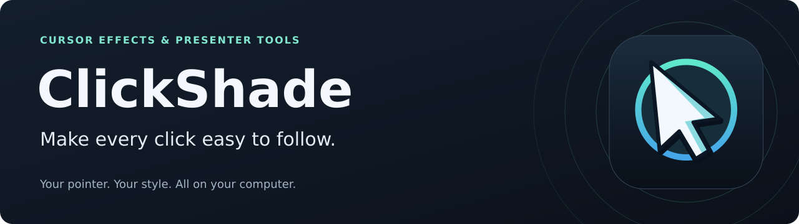
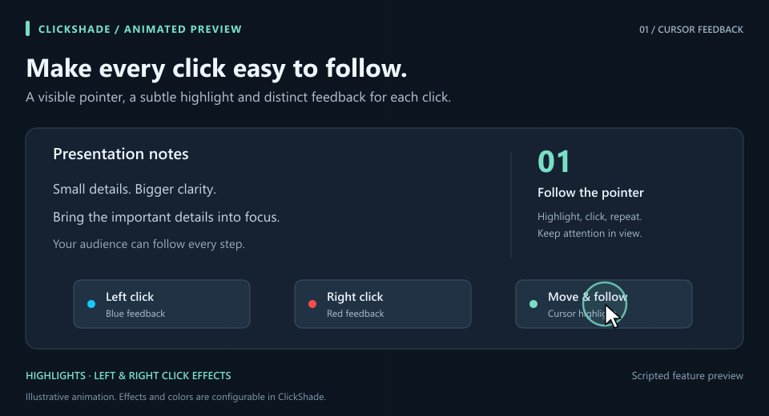
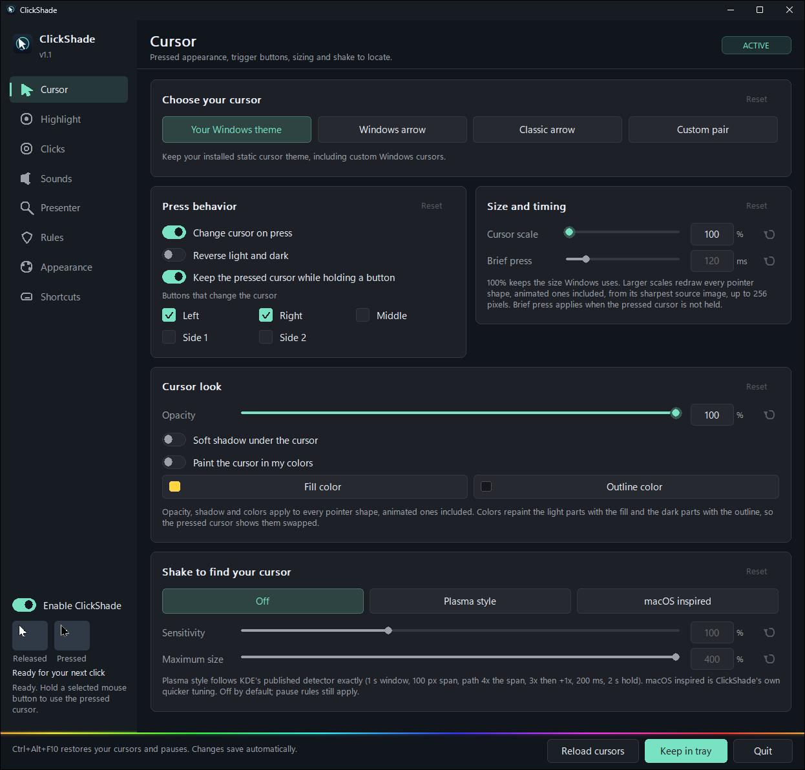
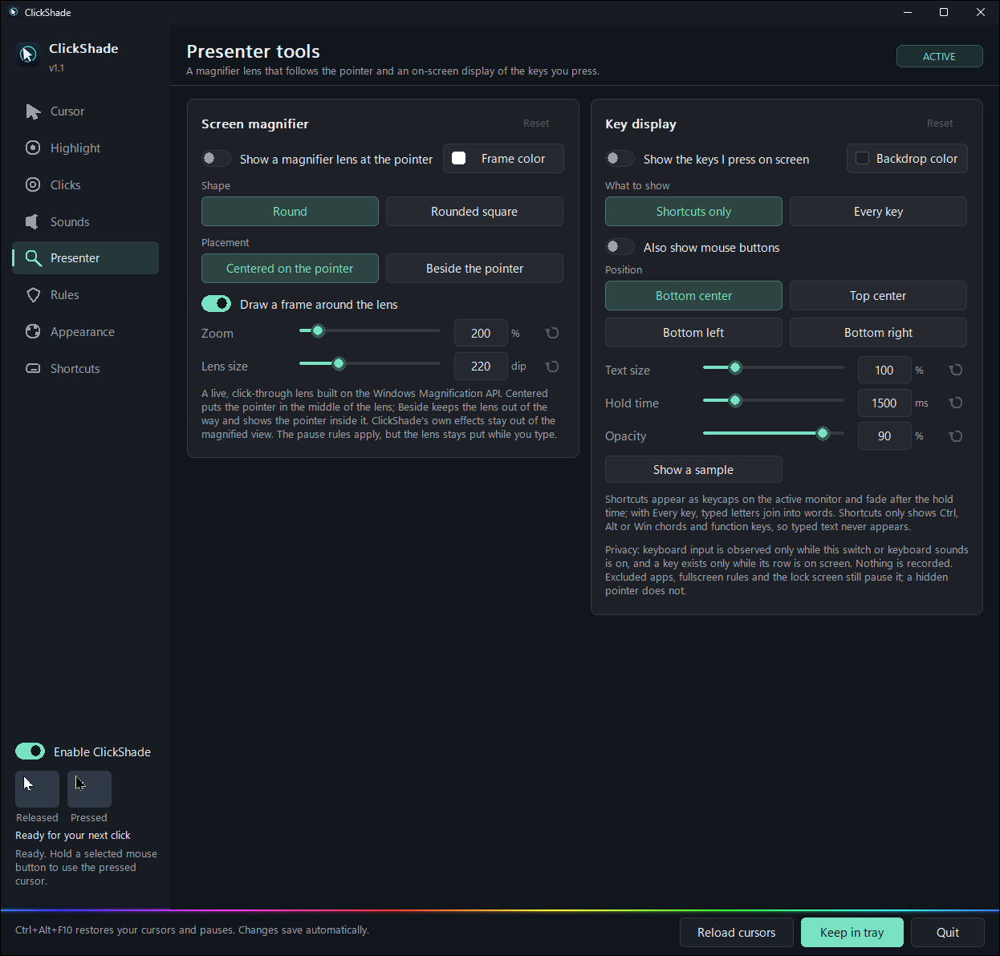
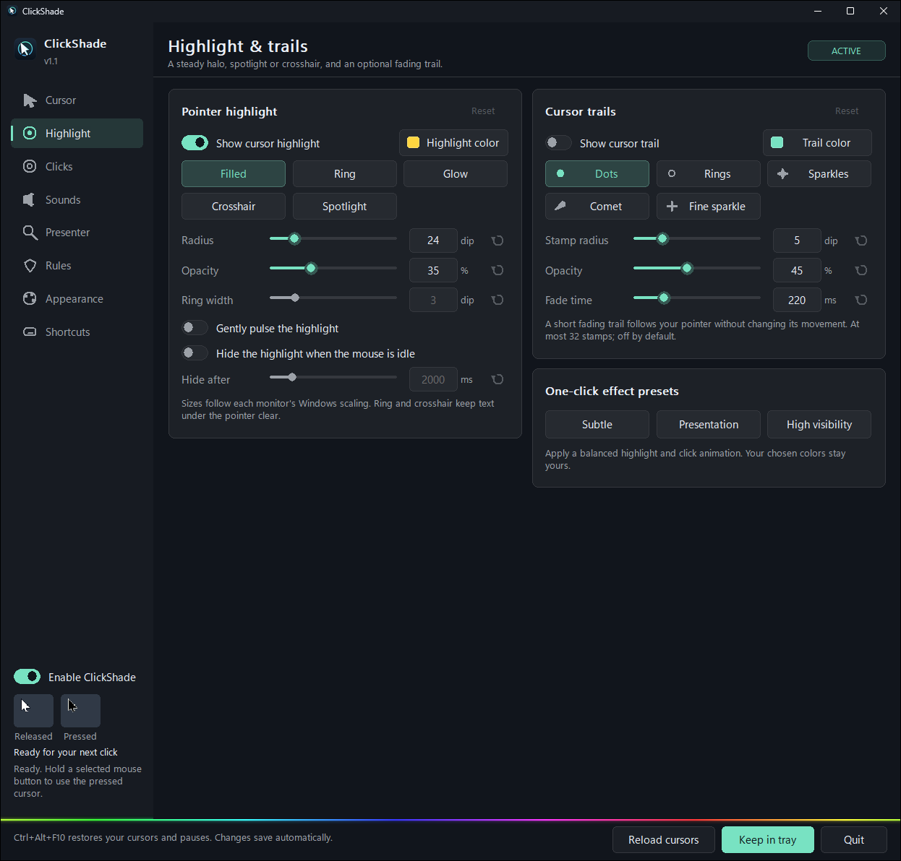
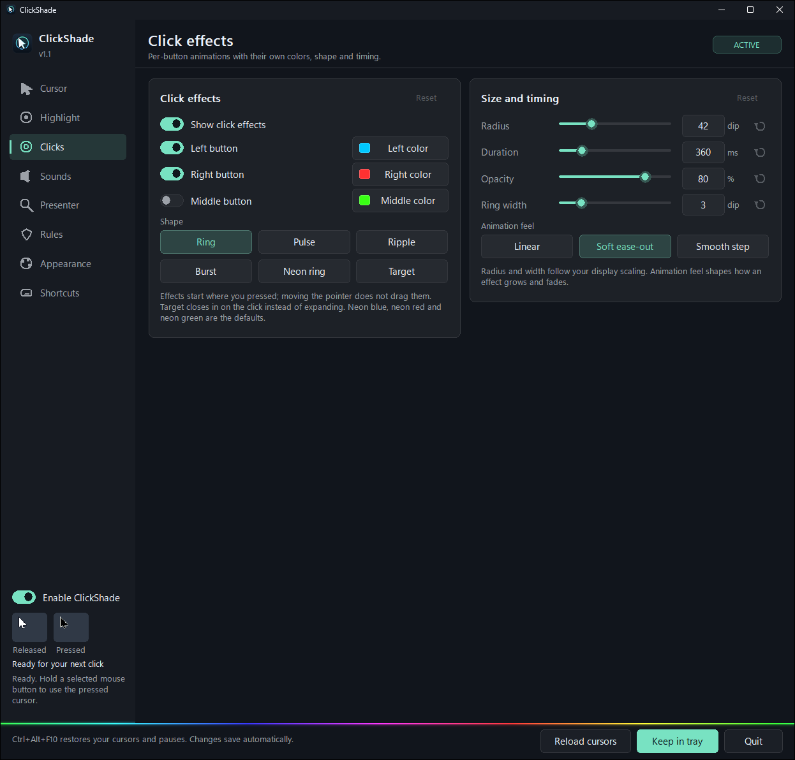
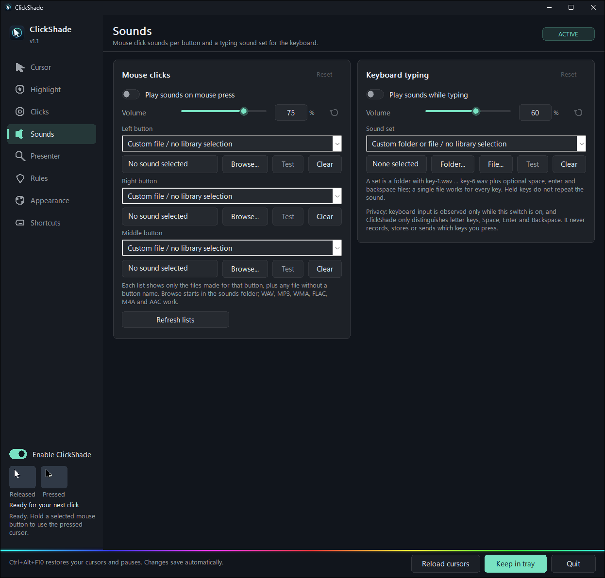
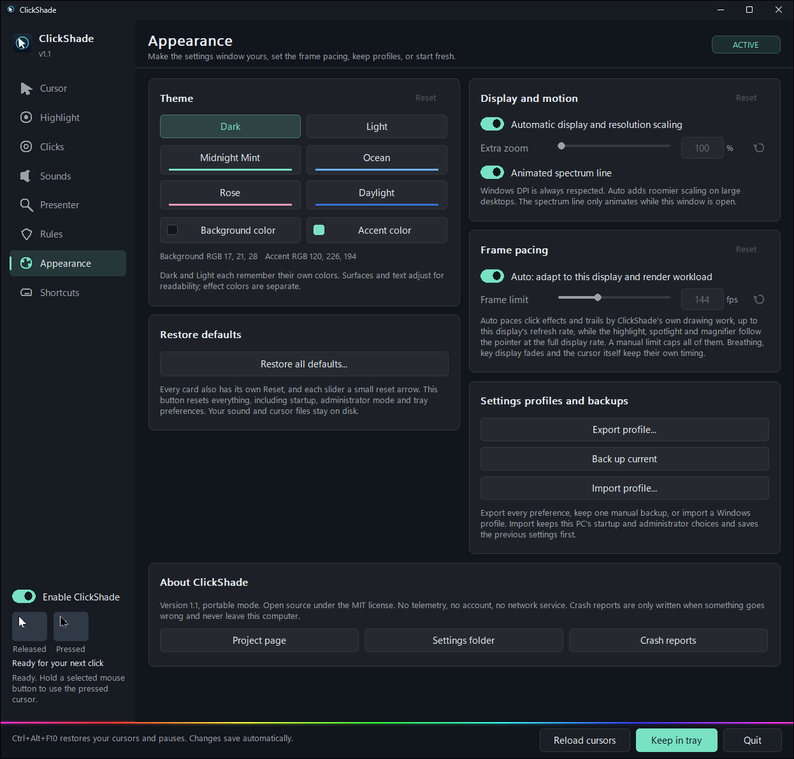
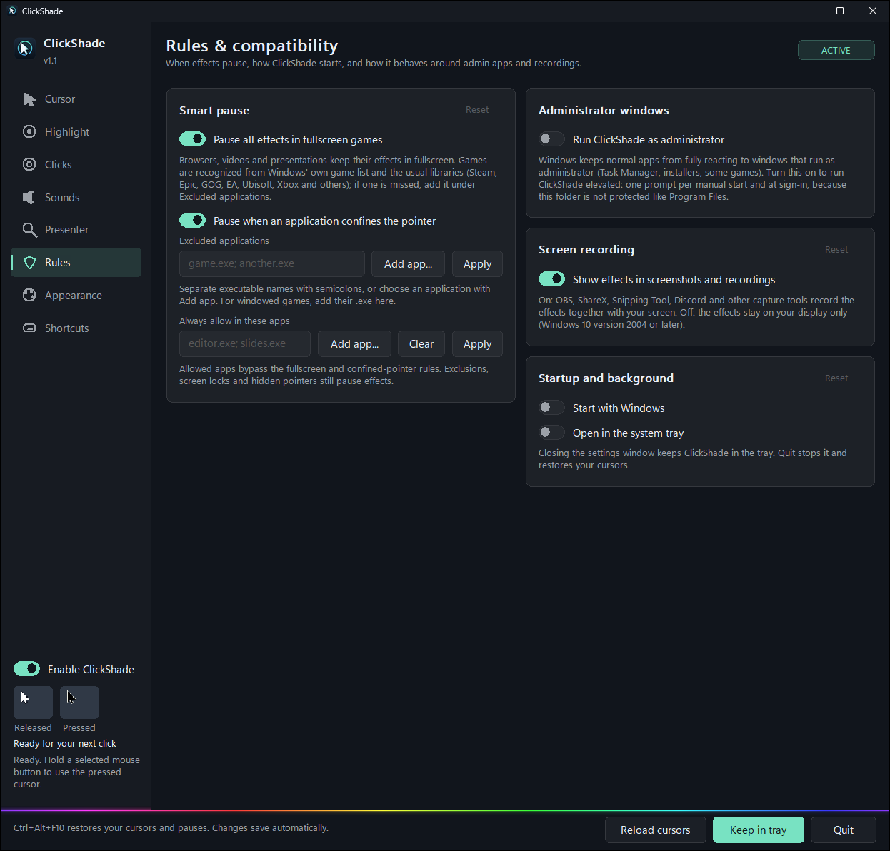
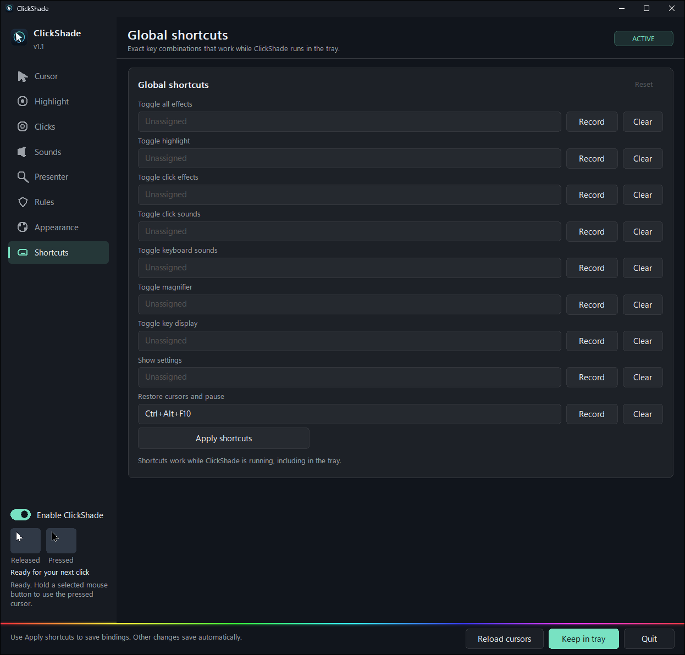

<p align="center">
  
</p>

<p align="center">
  Cursor highlights, click effects, a magnifier and on-screen keystrokes.<br>
  Make presentations, tutorials and everyday desktop use easier to follow.
</p>

<!-- The release workflows maintain this stable asset name for /releases/latest/download/. -->
<p align="center">
  <a href="https://github.com/NeTriXoN-BoT/clickshade/releases/latest/download/ClickShade-Windows-Linux.zip"></a>
  <a href="https://github.com/NeTriXoN-BoT/clickshade/releases/latest"></a>
</p>

<p align="center">
  <strong>Latest stable release</strong> · Windows 10 / 11 (64-bit) · Linux (x86-64)<br>
  Free and open source · No account · No telemetry
</p>

<p align="center">
  <a href="#get-started">Get started</a> ·
  <a href="#features">Features</a> ·
  <a href="#screenshots">Screenshots</a> ·
  <a href="#help">Help</a> ·
  <a href="#technical-details">Technical details</a>
</p>

<p align="center">
  
  <br>
  <sub>Scripted Windows feature showcase. GIF is silent; Linux capabilities vary. <a href="#features">Explore all features.</a></sub>
</p>

## Get started

**New to GitHub?** Click **Download ClickShade** above to download the app directly. The ZIP includes both platforms; no GitHub account or build tools are needed.

### Windows

1. **Download and extract.** Right-click `ClickShade-Windows-Linux.zip`, choose **Extract All…**, and save it somewhere you want to keep the app.
2. **Open ClickShade.** Open the extracted `Windows` folder and double-click `ClickShade.exe`. Keep the `sounds` folder beside it.
3. **Make it yours.** The settings window opens immediately. Choose your cursor, highlight and click effects. Changes save automatically.

Requires Windows 10 version 1703 or later, or Windows 11, **64-bit**. No installer or extra runtime is required. Closing settings keeps ClickShade in the system tray; choose **Quit** from its tray menu to stop it and restore your cursors.

> [!IMPORTANT]
> The Windows app is **unsigned**, so SmartScreen may warn on first launch. While running, ClickShade temporarily replaces the system cursors and restores them when paused or quit. If it is ever forcibly closed and your cursor stays changed, run `Restore-cursors.cmd` from the extracted `Windows` folder or press **Ctrl+Alt+F10** while ClickShade is running. See [security information](SECURITY.md).

<details>
<summary><strong>Linux setup and compatibility</strong></summary>

Extract the same ZIP, open a terminal in its `Linux` folder, then run:

```sh
chmod +x ClickShade
./ClickShade
```

Keep the `sounds` folder beside the executable. The supplied x86-64 build requires GTK 3.24, GLib, Cairo, GLIBC 2.38 / GLIBCXX 3.4.32 or newer, and X11 with XInput 2.1, XFixes 4 and a compositing window manager. Sound uses PulseAudio or PipeWire's PulseAudio service.

GNOME Wayland needs the bundled experimental Shell extension. Other Wayland compositors are unsupported, and some Windows features are unavailable on Linux. Read the [Linux setup guide](linux/README.md) and [platform comparison](#platform-support) before downloading.

</details>

<details>
<summary><strong>Updating, portable settings and checksums</strong></summary>

To update, quit ClickShade and extract the new release over your existing folder, or into a new one. Your settings carry over. If you move the app, enable **Start with Windows** again from its new location. GNOME users should reinstall the bundled extension after updating and log out and back in.

To keep Windows settings beside the app, create an empty file named `ClickShade.portable` next to `ClickShade.exe`. The app then stores `settings.ini`, `profiles` and `crash-reports` there. Keep those files when updating.

`CHECKSUMS.sha256` in the ZIP covers every other file in the archive. [All releases](https://github.com/NeTriXoN-BoT/clickshade/releases) include the downloadable app; GitHub's automatically generated **Source code** archives are for building it yourself.

</details>

## Features

| | What you can do |
| --- | --- |
| **Make your pointer stand out** | Add a highlight, soft glow, crosshair or spotlight. On Windows, resize and recolor every cursor shape, add a shadow, or darken it while clicking. |
| **Show every click** | Choose from six click animations, set a color for each mouse button, and add optional pointer trails. |
| **Present with clarity** | Enlarge details with a live magnifier and show shortcuts or typed keys on screen. Include effects in recordings or hide them from capture on Windows. |
| **Add sound feedback** | Pick from eleven mouse sound sets and five keyboard sets, with separate controls and volume. Sounds are off by default. |
| **Fit your workflow** | Pause in fullscreen games, exclude individual apps, and control effects from the tray or configurable shortcuts. |
| **Keep your own style** | Use dark or light settings, adjust colors and interface zoom, and save profiles with backup and import. |

Windows provides the full feature set. See [platform support](#platform-support) for Linux and experimental GNOME Wayland differences.

<details>
<summary><strong>Explore the complete feature list</strong></summary>

| Feature | What you get |
| --- | --- |
| Cursor on press | Hold a mouse button and the cursor switches to a dark version; release and it comes back. Reverse light and dark, keep it while holding or flash it briefly, and choose which buttons trigger it. |
| Cursor styles and size | Your installed theme, the Windows arrow, a classic arrow drawn crisply at any size, or your own `.cur` pair. A cursor scale from 100% to 600% of the size Windows uses applies to every cursor shape, the busy spinner included. Every cursor, animated ones included, stays crisp at any pointer size and display scaling. |
| Cursor look | Fade the cursor down to 30% opacity, give it a soft drop shadow, or paint it in your own fill and outline colors. Like the scale, the look reaches every cursor shape, animated ones included, and works with or without the press effect. |
| Shake to find | A Plasma-style preset that follows KWin's published detector exactly, or a macOS-inspired one that reacts to a couple of quick wiggles. Sensitivity and maximum size are yours to set. |
| Highlight | Filled, ring, soft glow, crosshair, or a spotlight that dims the rest of the screen. Color, radius, opacity and width, optional breathing, and hide-when-resting. |
| Trails | Dots, rings, sparkles, a tapered comet or a fine sparkle, with color, size, opacity and fade. Off by default. |
| Click effects | Ring, pulse, ripple, burst, neon ring, or a target that closes in on the click. Left, right and middle buttons each have their own switch and color; neon blue, neon red and neon green by default. |
| Click sounds | Eleven original sets including the classic mouse click, each dropdown listing only the files made for that button, or any WAV, MP3, FLAC, M4A or AAC file. |
| Keyboard sounds | A separate switch, volume and shortcut. Five sets, from classic typing to a typewriter, with shuffled key variants plus space, enter and backspace. |
| Magnifier | A live lens that follows the pointer, round or rounded square, centered on the pointer or beside it, 1.25× to 8×. Your own highlights and click effects stay out of it. |
| Key display | The keys you press, shown as keycaps on rounded panels in the style of the Mac keystroke visualizers: shortcuts only (Ctrl, Alt or Win chords and function keys) or every key, with typed letters joined into words. Optional mouse buttons, four positions, size, hold time and colors. A row lives only while it is on screen. |
| Smart pause | Pauses in fullscreen games, when a game confines the pointer and on the lock screen; browsers, video players and presentations keep their effects in fullscreen. Pointer effects and click sounds hide while an app hides the pointer, and the key display and typing sounds keep going. Exclude any executable, or allow-list the desktop tools that should keep working. |
| Administrator mode | Optional. Keeps effects, shortcuts and held-button tracking working over Task Manager, installers and other elevated windows. It starts with Windows without a prompt when ClickShade was copied or extracted into a protected folder such as Program Files. |
| Recordings | Effects show up in OBS, ShareX, the Snipping Tool and similar tools. One switch keeps them off recordings instead. |
| Crash recovery | If ClickShade crashes, it restores your cursors first, writes a report to the settings folder, and comes back with a note. After three restarts in a row it stops and tells you instead. |
| Settings window | A sidebar, compact cards, a reset on every card and every slider, dark and light palettes, extra zoom, and an animated spectrum line you can turn off. |
| Everyday controls | Nine global shortcuts, tray menu, optional start with Windows, settings profiles with backup and import, and a full defaults reset. |

</details>

## Screenshots

<table>
  <tr>
    <th>Cursor customization</th>
    <th>Presenter tools</th>
  </tr>
  <tr>
    <td><a href="assets/screenshots/windows-cursor.png"></a></td>
    <td><a href="assets/screenshots/windows-presenter.png"></a></td>
  </tr>
</table>

<details>
<summary><strong>More screenshots</strong></summary>

| Highlights | Click effects |
| --- | --- |
|  |  |
| **Sounds** | **Appearance** |
|  |  |
| **Rules** | **Shortcuts** |
|  |  |

</details>

## Using ClickShade

On first launch, holding the left or right mouse button darkens the cursor, a yellow highlight follows the pointer, and clicks draw blue or red neon rings. Sounds, trails, shake to find, middle-click effects, the magnifier and key display are off until you enable them. Administrator mode and start with Windows are also opt-in.

Use the tray menu to toggle effects, reopen settings, pause or quit. The default restore-and-pause shortcut is **Ctrl+Alt+F10** on Windows and **Ctrl+Shift+F10** on Linux. Other shortcuts are unassigned until you set them.

The [settings guide](docs/SETTINGS.md) explains every control and range.

<details>
<summary><strong>Settings pages, shortcuts and command-line options</strong></summary>

The window has eight pages. Every setting saves as you change it, and every card has a **Reset** that only lights up when something in it differs from the default.

| Page | What is there |
| --- | --- |
| Cursor | Cursor style, press behavior, trigger buttons, cursor scale and brief-press timing, cursor look (opacity, shadow, colors), shake to find. |
| Highlight | Highlight style and tuning, breathing, idle hide, trails, three one-click presets. |
| Clicks | Per-button switches and colors, click style, radius, duration, opacity, width, easing. |
| Sounds | Click sounds per button, keyboard sound set, both volumes, library refresh. |
| Presenter | Magnifier lens (shape, placement, zoom, size, frame color or no frame) and key display (what to show, mouse buttons, position, size, hold time, opacity, backdrop). |
| Rules | Fullscreen-game and confined-pointer pause, excluded and allowed apps, administrator mode, recording visibility, startup. |
| Appearance | Dark or light palette, presets and custom colors, extra zoom, spectrum line, frame pacing for all effects, profiles, restore all defaults. |
| Shortcuts | Nine global shortcuts, recorded or typed. |

[docs/SETTINGS.md](docs/SETTINGS.md) explains every control and range.

### Shortcuts and tray

| Action | Default |
| --- | --- |
| Restore cursors and pause | **Ctrl+Alt+F10** on Windows, **Ctrl+Shift+F10** on Linux |
| Toggle all effects, highlight, clicks, click sounds, keyboard sounds, magnifier, key display, show settings | Unassigned until you set them |

The tray menu offers the same toggles, restore and quit. Shortcuts need Ctrl, Alt or Win plus a key; Windows reserves F12.

### Command line

| Command | Effect |
| --- | --- |
| `ClickShade.exe` | Open the settings window, or bring the running instance forward |
| `ClickShade.exe --tray` | Start in the tray |
| `ClickShade.exe --restore` | Restore the Windows cursors and pause the running instance |
| `ClickShade.exe --quit` | Quit the running instance |
| `ClickShade.exe --no-elevate` | Start without the administrator relaunch this time |
| `ClickShade.exe --version` | Show the version |

Only one instance runs per session; a second launch just opens the settings window. The Linux binary accepts `--background`, `--restore`, `--quit`, `--version` and `--help`.

</details>

## Help

For a bug or feature request, [open an issue](https://github.com/NeTriXoN-BoT/clickshade/issues). Include your operating system, ClickShade version and what happened. For security reports, see [SECURITY.md](SECURITY.md).

<details>
<summary><strong>Troubleshooting</strong></summary>

| Symptom | Likely cause |
| --- | --- |
| The cursor stayed dark or changed after ClickShade was killed | Run `Restore-cursors.cmd` from the download or `ClickShade.exe --restore`; signing out also resets the scheme. |
| Effects vanish over Task Manager, installers or some games | Those windows run elevated. Turn on **Run ClickShade as administrator** on the Rules page. |
| Windows asks for approval at every sign-in | Administrator mode starts silently only from a protected folder such as Program Files. Copy the ClickShade folder there (a folder moved on the same drive keeps your account as owner and still counts as unprotected), start that copy and switch **Start with Windows** on again. |
| Effects pause in an app that is not a game | The confined-pointer rule fired, or the app is on Windows' game list or runs from a game library folder and was taken for a fullscreen game. Add it to **Always allow in these apps**, or turn the rule off. |
| Effects keep running in a fullscreen game | ClickShade did not recognise it as a game. Add its executable under **Excluded applications** on the Rules page. |
| Effects disappear while a video plays | The player hid the pointer, as YouTube does when the mouse rests. Move the mouse and they come back; the key display keeps working meanwhile. |
| No effects in a particular app | It may be in the excluded list, or the session is locked, or the app hides the pointer itself. |
| Effects missing from OBS or ShareX recordings | **Show effects in screenshots and recordings** is off on the Rules page. |
| No sound | Sounds are off by default. Use **Test** next to a file; a missing codec or device shows an error on the Sounds page. |
| A shortcut does nothing | Another app owns that combination, or it is a bare key. Pick a different chord; the page reports conflicts. |
| The magnifier reports an error or stays hidden | The Windows Magnification API is missing or blocked in that session (some stripped-down or remote setups). Every other effect keeps working. |
| The key display shows nothing while typing | **Shortcuts only** is selected. Press a Ctrl, Alt or Win chord, or choose **Every key** on the Presenter page. |
| SmartScreen or antivirus warns about the EXE | The binary is unsigned. Build from source if you want to verify it; see [SECURITY.md](SECURITY.md). |
| Linux: no highlights or click effects | X11 needs a compositing window manager and XInput 2.1. On GNOME Wayland, install the extension from `Linux/gnome-extension`. |

</details>

<details>
<summary><strong>Uninstall ClickShade</strong></summary>

Turn off **Start with Windows** (and administrator mode, which removes its scheduled task), choose **Quit**, then delete the extracted folder. Settings live in `%LOCALAPPDATA%\ClickShade` on Windows and `~/.config/clickshade` on Linux; delete them too if you want a clean slate. Quit removes the temporary cursor files ClickShade keeps under `%TEMP%\ClickShade` while it runs. ClickShade never deletes sound or cursor files you selected.

</details>

## Technical details

<details>
<summary><strong>Requirements and platform support</strong></summary>

### Requirements

**Windows:** Windows 10 version 1703 or later, or Windows 11, 64-bit. No installer, no runtime to install.

**Linux:** an x86-64 system with GTK 3.24, GLib, Cairo, X11 with XInput 2.1 and XFixes 4, a compositing window manager, and GLIBC 2.38 / GLIBCXX 3.4.32 or newer. Sound uses PulseAudio or PipeWire's PulseAudio service. GNOME on Wayland needs the bundled Shell extension; other Wayland compositors are not supported. See [linux/README.md](linux/README.md).

### Platform support

| Capability | Windows | Composited Linux X11 | GNOME Wayland adapter |
| --- | --- | --- | --- |
| Highlight styles, breathing, idle hide | Yes | Yes | Experimental (spotlight drawn as a glow) |
| Left, right and middle click styles | Yes | Yes | Experimental |
| Five trail styles | Yes | Yes | Not implemented |
| Current cursor dark on press | Native system-role replacement | Software overlay of the current static cursor | Not implemented |
| Reverse, custom pairs, default/classic presets, cursor sizing | Yes | Not implemented | Not implemented |
| Shake-to-locate enlargement | Cached native system arrow | Cached current-cursor overlay | Use compositor facilities |
| Magnifier lens | Windows Magnification API, centered or beside the pointer, own overlays excluded | Beside the pointer, read from the screen as the pointer moves and about 30 times a second at rest | Square lens beside the pointer, cloned from the window layer |
| Key display | Yes | Yes | Yes (Shell widgets) |
| Fullscreen-game pause, app exclusions and allowances | Yes | Yes | Experimental (Shell window information) |
| Administrator mode, capture visibility, crash recovery | Yes | Not applicable | Not applicable |
| Global shortcuts | RegisterHotKey | X11 passive grabs | Not implemented |
| Click and keyboard sounds | WAV + installed Windows codecs through WASAPI | WAV + PulseAudio-compatible server | Bridge; see adapter guide |
| Settings window, profiles, full reset, startup | Yes | Yes | Same GTK settings app |

Xwayland is not a route to global native Wayland input. KDE Plasma, wlroots and other Wayland compositors would need dedicated adapters; the GNOME extension does not cover them. The supplied binaries are x64 builds.

</details>

<details>
<summary><strong>Build from source and contribute</strong></summary>

ClickShade is C++17. On Windows it observes the mouse through Raw Input without blocking it, replaces system cursor roles with its own prepared multi-size cursor files, draws effects in small click-through layered windows paced by one-shot timer deadlines, hosts the magnifier lens in the Windows Magnification API, and mixes sound in a sixteen-voice WASAPI mixer with a waveOut fallback. A dedicated receiver thread keeps accessibility-event floods out of the input and render queues. On Linux it uses XInput 2 and XFixes with Cairo overlays, and talks to the GNOME extension over D-Bus. The design is written up in [docs/ARCHITECTURE.md](docs/ARCHITECTURE.md), and the effect references (KDE, Apple, screen-recorder conventions) in [docs/EFFECTS.md](docs/EFFECTS.md).

### Windows with Visual Studio

```bat
cmake -S . -B build-msvc -A x64 -DCLICKSHADE_BUILD_TESTS=ON
cmake --build build-msvc --config Release
```

### Windows cross-build with Zig

```text
python tools/build_zig.py --zig /path/to/zig --test
```

Builds the app and the developer checks in `build/`. The cursor, runtime and overlay suites need `--run` on an idle desktop with the app closed. They move the mouse and replace cursors while they run; the runtime suite also opens a fullscreen test window and a fullscreen test "game" (a copy of itself in a temporary Steam-style folder under `%TEMP%`), and the overlay suite presses F24, a key with no standard function, and writes its screenshots beside `visual_smoke.exe`. Leave the mouse and keyboard alone meanwhile.

### Linux

```sh
sh linux/build.sh --test
# Or:
cmake -S . -B build-linux -DCMAKE_BUILD_TYPE=Release -DCLICKSHADE_BUILD_TESTS=ON
cmake --build build-linux -j
ctest --test-dir build-linux --output-on-failure
node linux/gnome-extension/tests.mjs
```

`python tools/package_release.py` builds the release ZIP from both binaries and checks architectures, freshness and checksums. The **Draft release** workflow does the same on GitHub for an existing tag. Contributions are welcome; see [CONTRIBUTING.md](CONTRIBUTING.md).

The **Draft release** workflow also attaches an identical copy named `ClickShade-Windows-Linux.zip`. The **Update download asset** workflow maintains that name when a release is published, including releases uploaded manually. The README's `/releases/latest/download/ClickShade-Windows-Linux.zip` link therefore follows the latest stable release without a README edit. To refresh the copy on an existing release, run **Update download asset** from Actions and enter its tag (or leave it blank for the latest stable release).

</details>

<details>
<summary><strong>Privacy and project transparency</strong></summary>

- It never moves the pointer, changes mouse speed or acceleration, or replays input. Effects follow the position Windows reports.
- It does not record what you type. Keyboard input is observed only while keyboard sounds or the key display are on. Sounds only learn whether an ordinary key, Space, Enter or Backspace went down; the key display turns a press into a keycap or a typed character that is dropped as soon as its row fades.
- It has no account, telemetry, activity log, updater or network service.
- It does not inject into games or work around anti-cheat. It pauses in fullscreen games by default; quit it entirely if a game's rules require that.

ClickShade is a young, one-person project built with AI coding assistants. The maintainer chooses the features, reviews the results and tests the application on real hardware; AI assistants have written a large share of the code, tests and documentation. If something looks wrong, please [report it](https://github.com/NeTriXoN-BoT/clickshade/issues).

</details>

## License

Licensed under the [MIT License](LICENSE). The code, the icon and banner, the fallback classic arrow and the example sounds are original. Windows cursor files are read from your own Windows installation and never redistributed. The Plasma-style shake preset follows the parameters published in KWin's source; no KDE code is included. Windows, macOS, KDE Plasma, XSplit, OBS and other names belong to their owners; ClickShade is not affiliated with any of them. Compiler and runtime notices are in [THIRD_PARTY_NOTICES](THIRD_PARTY_NOTICES).
